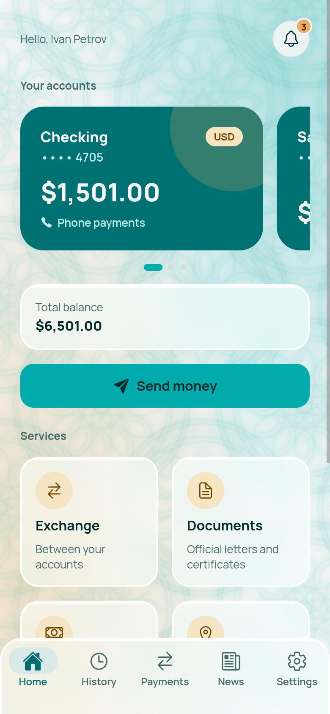
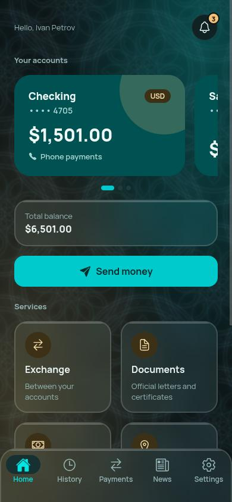
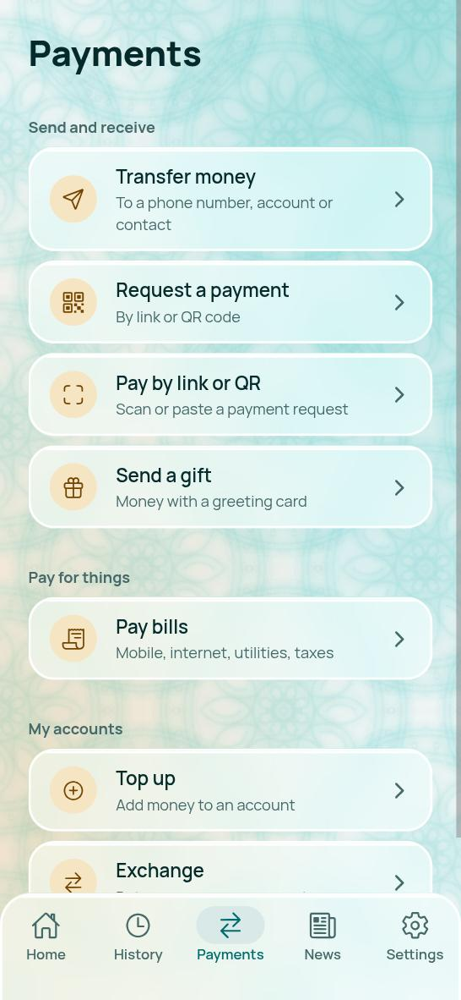
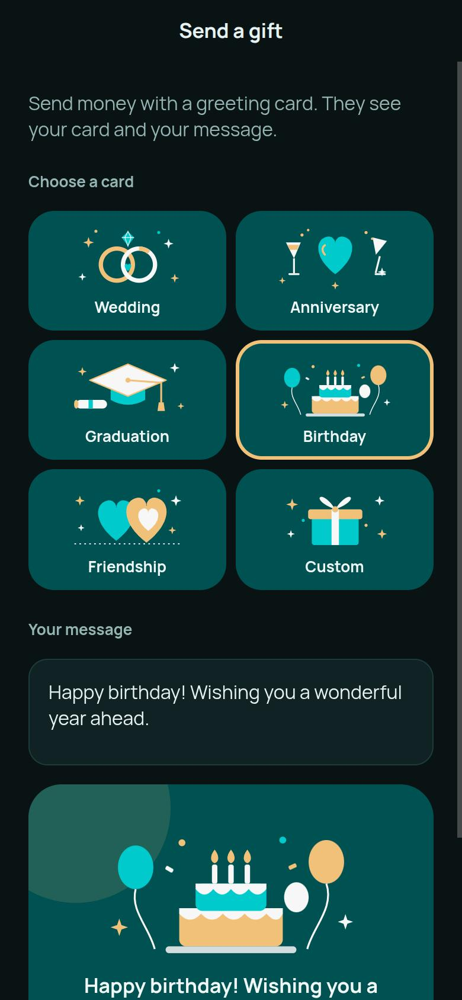
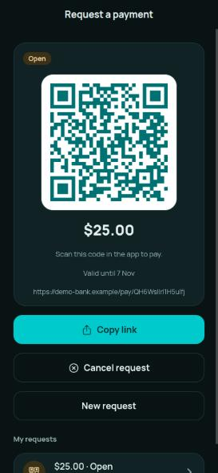
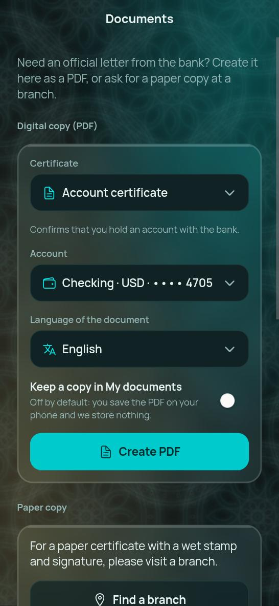
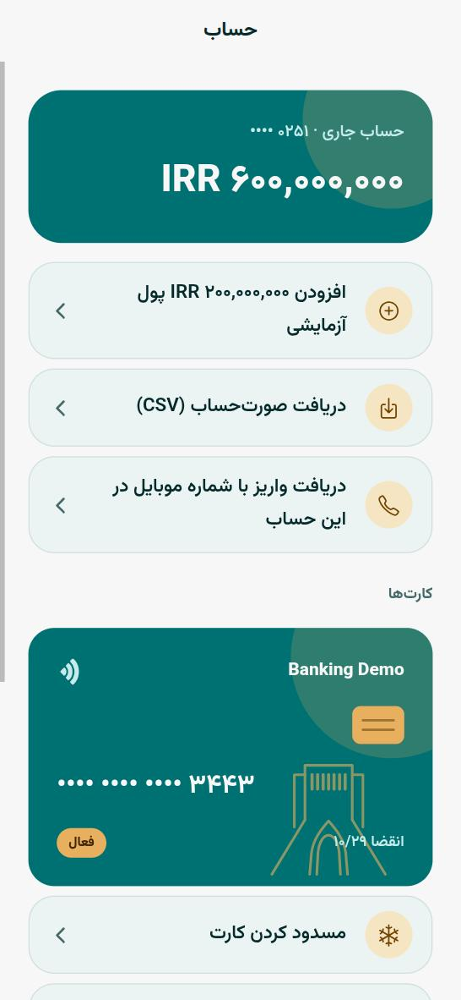
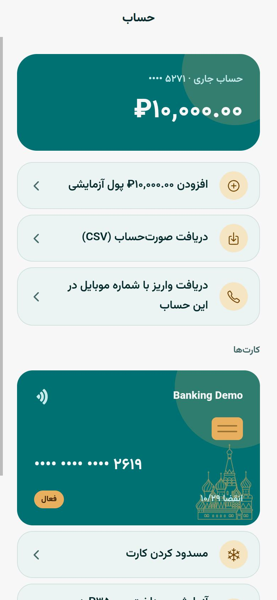
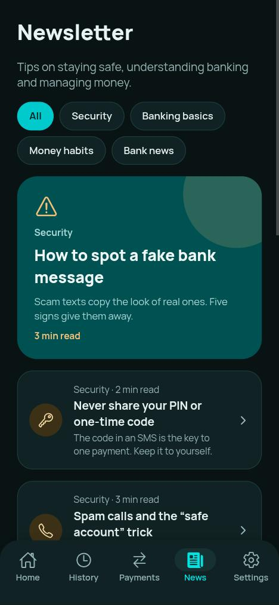

# Banking Demo

A mobile banking application using simulated money. The client is a React Native (Expo) app; the server is FastAPI with PostgreSQL.

The project concentrates on the parts of banking software where correctness matters most: a double-entry ledger, idempotent
payments, step-up authentication (payment PIN and one-time codes), multi-currency accounts with currency exchange, and an interface
in three languages (English, Russian, Persian) with right-to-left layout support.

<p align="center">
  
  
  
</p>

> All data is fictional: the bank, branches, addresses, phone numbers and money. Exchange rates are retrieved from free public
> APIs. No real payment is made and no message is sent.

## Contents

1. [Features](#features)
2. [Technical design](#technical-design)
3. [Architecture](#architecture)
4. [Installation and running](#installation-and-running)
5. [Testing and code quality](#testing-and-code-quality)
6. [Security](#security)
7. [Limitations](#limitations)
8. [Roadmap](#roadmap)
9. [Deployment](#deployment)
10. [Repository layout](#repository-layout)
11. [Documentation](#documentation)
12. [Licence](#licence)

## Features

| Area | Description |
|---|---|
| Accounts | Checking and savings accounts in rubles, rials or US dollars (up to eight per customer); swipeable account cards; one virtual card per account that can be frozen, with artwork specific to each currency. |
| Deposits and top-ups | Simulated deposits and top-ups by card, bank transfer or cash. |
| Transfers | By phone number, account number or phone contact. The recipient is shown as a masked name before confirmation. Confirmed with the payment PIN, with an SMS code for larger amounts and an optional fingerprint. |
| Exchange | Conversion between a customer's own accounts in different currencies at the current rate, recorded as two linked ledger transfers (see [Multi-currency and exchange](docs/ARCHITECTURE.md#multi-currency-and-exchange)). |
| Payment requests | A link and QR code that can be opened or scanned in the app. Fixed or open amount, cancellation, expiry, single payment. |
| Bills | Mobile operators, internet, utilities, taxes and fines, and charities, for Russia (rubles) and Iran (rials). |
| Gifts | Money sent with a greeting card (wedding, anniversary, graduation, birthday, friendship or a custom message), drawn as vector artwork. |
| History | All transactions across accounts, filtered by account or card, by period (selection list and calendar; Jalali calendar for Persian) and by direction, with totals per currency. Grouped by month with collapsible months. |
| Transaction details and receipts | Each transaction opens in full (type, both parties, accounts, exchange rate, card, balance after, a receipt number shared by both parties). The receipt is available as a PDF that can be opened, saved, shared or printed in English, Russian or Persian. |
| Documents | Official certificates as PDFs: account, balance, statement, bank details, proof of income, proof of funds, customer, no debt. Created on the device; stored on the server only on request. |
| Account and card services | Per-account history with filters; ordering of a physical card (details check, light or dark design, branch selection, notification by app or telephone, pending status until ready); blocking of an account or card, immediate for predefined reasons and subject to specialist approval for a free-text reason; lost or stolen card procedure with replacement offer. |
| Insurance | Travel, medical, car and home insurance. The price is converted into the currency of the paying account using the same code and rates as the exchange. Payment requires the PIN, and an SMS code above the threshold. The policy certificate is a PDF issued in the account holder's name. Demonstration only; not an insurance contract. |
| Exchange rates | Currency calculator for seven currencies, using two public rate APIs with caching and fallback. |
| Branches | Fictional Moscow branches on a built-in map, with directions in Yandex Maps, 2GIS, Google Maps, Apple Maps or the device navigator. |
| Support | Contact details and a chat screen with a placeholder assistant. |
| News | Articles on fraud awareness, how banking works, money management and bank news. |
| Security | Device sessions that can be revoked, sign-in throttling, PIN lockout, one-time codes, application lock with fingerprint, notifications for sign-ins and payments. |
| Languages | English, Russian, Persian. The language changes immediately without a restart. Right-to-left layout, Persian digits and fonts are supported. |

<p align="center">
  
  
  
</p>
<p align="center">
  
  
  
</p>

## Technical design

The reasoning and trade-offs behind each decision are recorded in [docs/DECISIONS.md](docs/DECISIONS.md).

- **Ledger.** Balances are not stored or edited. Every transfer appends two ledger rows that cancel out, and a balance is their running
  sum. A database trigger rejects `UPDATE` and `DELETE` on ledger rows. The function `verify_ledger()` audits the totals overall,
  per currency, and checks that no row is in the wrong currency.
- **Money representation.** Amounts are integers in the smallest unit of the currency (cents, kopecks, and the rial itself). Floating
  point is not used at any layer.
- **Idempotency.** The app creates one idempotency key per confirmation and reuses it on retries. The server answers a repeated
  request with the original result. Concurrent identical requests are covered by tests.
- **Concurrency.** Accounts are locked in a fixed order within the transaction that writes the ledger rows, which prevents both
  double spending and deadlock.
- **Step-up authentication.** A six-digit PIN (argon2 hash, lockout stored in the database) and, for larger amounts, a one-time
  SMS code bound to the specific payment, single use and time limited. An incorrect PIN or code returns status 403 rather than 401,
  because the app treats 401 as an expired access token.
- **Currency exchange.** An exchange consists of two ordinary transfers through per-currency pool accounts, so every ledger rule
  continues to apply. The client sends the amount it was shown; if the rate has changed, the server refuses with `rate_changed`.
- **Errors.** The server returns a stable error code with parameters (for example `pin_invalid` with `left: 4`). The app composes the
  message in the user's language.
- **Design system.** Each colour has a defined role, validated against WCAG contrast ratios by an automated test.
- **Right-to-left support.** Layout direction is set by the application so that language changes take effect immediately. Numbers and
  names are isolated from the surrounding text, and Persian digits and the Jalali calendar are supported.

## Architecture

```
   Mobile app (Expo / React Native / TypeScript)
        │  HTTPS, JSON, Bearer token
        ▼
   Caddy  (TLS certificates, production only)
        │
        ▼
   FastAPI  ── routes (request handling)
        │        └── services (business rules; do not commit)
        │              └── models (SQLAlchemy 2)
        ▼
   PostgreSQL  ── ledger (append-only, trigger-protected), accounts, users, requests, ...
        ▲
        └── Alembic migrations (the tests build their database from them)

   External: two public exchange-rate APIs (server side, cached) · simulated SMS inbox · map tiles
```

The data model, the ledger and the payment flow are described in [docs/ARCHITECTURE.md](docs/ARCHITECTURE.md).

## Installation and running

Requirements: Docker, Node.js 22, and Python 3.12 (for the backend tests).

```bash
# 1. Backend and database (migrations run on start; API on port 8100, PostgreSQL on 5444)
docker compose up -d --build

# 2. Optional: demonstration customers with history
docker compose exec api python -m scripts.seed_demo

# 3. Mobile app
cd frontend
npm install
npx expo start
```

- The seed script prints the demonstration sign-ins (`ivan@example.com`, `anna@example.com`, `oleg@example.com`). The demonstration
  password and PIN are defined in `backend/scripts/seed_demo.py`.
- **Physical device:** install Expo Go and connect to the same network as the computer. If a VPN is in use, allow local network
  access or disable it. The app derives the API address from the Expo development server; set `EXPO_PUBLIC_API_URL` to override.
- **Browser:** press `w` in the Expo terminal. Fingerprint, contacts and camera are unavailable in the browser.
- **API documentation:** http://localhost:8100/docs while the stack is running, and [docs/API.md](docs/API.md).

## Testing and code quality

```bash
cd backend
python3 -m venv venv && ./venv/bin/pip install -r requirements.txt     # once
./venv/bin/python -m pytest                    # requires the PostgreSQL container
./venv/bin/python -m ruff check .

cd ../frontend
npx tsc --noEmit && npx expo lint && npx jest
```

- **Backend:** approximately 400 tests against a real PostgreSQL database built from the migrations. They include concurrency tests
  (double spending, deadlock, simultaneous identical requests, simultaneous incorrect PIN attempts) and checks in which each key
  safeguard was disabled once to confirm that a test fails without it.
- **Frontend:** approximately 335 tests of the pure logic: money parsing and formatting, calendars (Gregorian and Jalali), map
  projection, translation catalogues (all keys present in all languages, identical placeholders, every key used in code defined),
  design-system contrast rules, document rendering, and directions links.
- **Static checks:** TypeScript strict mode. The Russian and Persian catalogues are typed against the English one, so a missing
  translation is a compile error.

## Security

| Layer | Measure |
|---|---|
| Sign-in throttling | Failed sign-ins counted per email and address, per email and per address; above the limit the server returns 429 with `Retry-After`. |
| Sessions | Short-lived access token and rotating refresh token. Reuse of an old refresh token ends that session. |
| Payment PIN | argon2 hash; weak PINs rejected; five failed attempts lock it for 15 minutes (counter stored in the database). |
| One-time codes | For amounts of about 50 US dollars or more in any currency: single use, bound to the payment, five-minute expiry, five attempts, stored only as a keyed hash. |
| Recipient privacy | Lookups return only a masked name, are rate limited, and "unknown" and "cannot receive" are indistinguishable. |
| Access control | Payment-request links carry an unguessable token. Other customers' accounts, cards, certificates, policies and transactions return 404. |
| Output encoding | Spreadsheet formulas are neutralised in CSV statements. Customer-supplied text is escaped in generated documents. |
| Transport | Production runs behind Caddy over HTTPS. Release builds of the app reject `http://`. HSTS and `no-store` headers are set. |
| Fail closed | In production the server refuses to start with the default secret key or database password. |

## Limitations

- The application lock is a screen lock. The refresh token is encrypted at rest by the platform keystore but is not itself
  protected by fingerprint; this requires a development build instead of Expo Go.
- The rate limiter is held in memory, so it applies to a single server process. Several workers would require a shared store.
- SMS is simulated by an in-app inbox. Notifications are retrieved when the screen is opened; push notifications would require
  Firebase and APNs.
- Cross-currency payments to other customers are rejected. Exchange applies to a customer's own accounts.
- Full card numbers are not stored; only the last four digits are kept.
- Map tiles are provided by the Esri basemap service and are suitable for demonstration, not production traffic.
- Camera scanning, the share sheet and saving of PDFs are device features and cannot be exercised in a browser.
- **Open issue: saving and sharing PDFs on Android (Expo Go).** The PDF is generated correctly on the device, but sharing it to some
  applications reports an unsupported file, and saving to a folder has not been verified. Details are in
  [docs/KNOWN_ISSUES.md](docs/KNOWN_ISSUES.md).

## Roadmap

Planned maintenance, in order of priority:

1. **Payment orchestration in one service.** The steps shared by transfers, bills, insurance and exchange (replay check, PIN, code,
   posting) are currently written in each route. They are to be extracted into a single service module, and `auth.py` is to move its
   queries into a service.
2. **Application-side reuse.** The transfer review screen is to use the shared PIN and code component. The repeated "busy, try, report
   error" pattern in screens is to become a single hook, and the exchange screen is to separate its logic from its layout.
3. **Shared constants.** Values duplicated by hand between server and app (currency decimals, branch identifiers, block reasons,
   certificate requirements, insurance plans) are to be covered by a contract test or served by the API.
4. **Continuous integration** for the backend and frontend checks.
5. **PDF saving and sharing on Android**, see [docs/KNOWN_ISSUES.md](docs/KNOWN_ISSUES.md).

## Deployment

```bash
cp .env.production.example .env.production     # set DOMAIN, SECRET_KEY, POSTGRES_PASSWORD
docker compose --env-file .env.production -f docker-compose.prod.yml up -d --build
```

Only Caddy publishes ports (80 and 443). It obtains and renews a Let's Encrypt certificate for `DOMAIN`. Set `DEMO_MODE=false` to
remove the simulated deposit, top-up, SMS and card-purchase endpoints. For the mobile app, set `EXPO_PUBLIC_API_URL=https://your-domain`
in `frontend/eas.json` before building with EAS. To run the production stack locally, use
`DOMAIN=localhost HTTPS_PORT=8443 HTTP_PORT=8480`; Caddy then issues a certificate from its own local authority.

## Repository layout

```
backend/            FastAPI application
  app/api/            routes and shared dependencies
  app/services/       business rules: ledger, conversion, payments, pricing, certificates, bills, insurance, ...
  app/models/         SQLAlchemy tables
  app/schemas/        request and response models
  alembic/            migrations
  scripts/            seed_demo.py, generate_api_docs.py
  tests/              pytest suite (real PostgreSQL)
frontend/           Expo application
  src/app/            screens (Expo Router: tabs, stack, authentication)
  src/components/     shared interface components (Text, Glass, PdfCard, PinEntry, ...)
  src/hooks/          shared hooks (usePagedList, usePdfDocument, useFocusData, ...)
  src/i18n/           catalogues (en, ru, fa), fonts, digits, direction, error messages
  src/lib/            pure logic: money, calendars, Jalali, text fitting, ...
  src/<feature>/      accounts, branches, cards, certificates, history, insurance, news, security, send, ...
docs/               architecture, decisions, known issues, generated API reference, screenshots
docker-compose.yml        development stack
docker-compose.prod.yml   Caddy, API and PostgreSQL with HTTPS
```

## Documentation

| Document | Contents |
|---|---|
| [docs/ARCHITECTURE.md](docs/ARCHITECTURE.md) | Data model, ledger, multi-currency exchange, payment flow, frontend and internationalisation, testing strategy |
| [docs/DECISIONS.md](docs/DECISIONS.md) | Significant decisions, with reasons and consequences |
| [docs/KNOWN_ISSUES.md](docs/KNOWN_ISSUES.md) | Open problems and what has been tried |
| [docs/API.md](docs/API.md) | Endpoint reference generated from the code |
| [backend/README.md](backend/README.md) | Backend guide: configuration, migrations, scripts, conventions |
| [frontend/README.md](frontend/README.md) | Frontend guide: structure, conventions, adding a screen or a language |

## Licence

Released under the MIT Licence. See [LICENSE](LICENSE). The files under `frontend/` that originate from the Expo project template
remain under their own licence.
